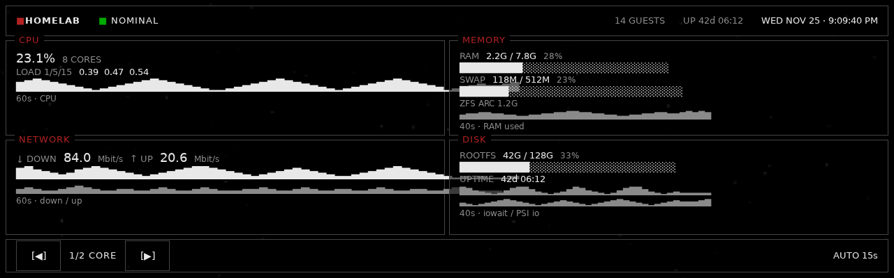
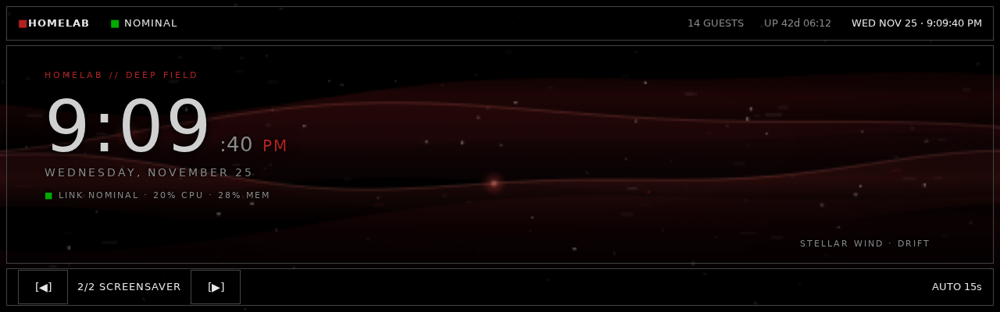

# homelab-screen

A fixed 1280×400 fullscreen kiosk for a Raspberry Pi. It rotates between a compact **CORE** metrics page and a **SCREENSAVER** page every 15 seconds. A small loopback-only snapshot collector serves live Proxmox VE data when configured, and falls back to clearly marked stub values otherwise.

## Screens

**CORE**



**SCREENSAVER**



## Layout

```
src/
  kiosk.html          single-file dashboard (HTML, CSS, JS)
  collector.py        loopback snapshot server / PVE poller
  kiosk.sh            Chromium launcher
  kiosk.service       browser systemd unit template
  collector.service   collector systemd unit template
scripts/
  install.sh          idempotent install, upgrade, rollback, status
config.env.example    environment template; real values stay on the host
tests/
  check.sh            syntax, privacy and stub-API smoke checks
docs/
  design-notes.md     chart and wording decisions
```

## Requirements

- Raspberry Pi 3 or newer running Raspberry Pi OS with `cage`, Chromium and systemd.
- Python 3.
- Optional: Proxmox VE with a **read-only** API token and its leaf certificate for live data.

## Install

Run the checks first:

```sh
sh tests/check.sh
```

On the Pi, copy this repository somewhere writable, then:

1. Create `/etc/homelab-screen/config.env` from `config.env.example` and fill in the local values.
2. Put the API token and certificate in `$HOME/.config/homelab-screen/` with mode `600`.
3. Install and start both services:

```sh
sh scripts/install.sh --user <USER>
```

For an offline display that only shows stub data:

```sh
sh scripts/install.sh --user <USER> --allow-stub
```

Verify:

```sh
sh scripts/install.sh --status
```

The header shows `NOMINAL` for live data and `DEGRADED` when the collector falls back to stub mode.

## Configuration

All deployment-specific values come from `/etc/homelab-screen/config.env`:

| Variable | Purpose |
| --- | --- |
| `PVE_API_BASE` | Proxmox API endpoint, e.g. `https://<HOST>:8006/api2/json` |
| `PVE_NODE` | Node name queried by the collector |
| `PVE_CERT_PIN` | SHA-256 pin of the PVE leaf certificate |
| `HOMELAB_LABEL` | Generic label shown in the kiosk header |
| `HOMELAB_TOKEN_FILE` | Token path override; defaults to `$HOME/.config/homelab-screen/pve-token` |
| `HOMELAB_CERT_FILE` | Certificate path override; defaults to `$HOME/.config/homelab-screen/pve-cert.pem` |
| `HOMELAB_PORT` | Collector listen port; defaults to `8080` |

The collector binds to `127.0.0.1` only. Tokens, certificates, real hostnames and addresses are never stored in this repository.

## Operations

Each install writes a timestamped backup under `$HOME/homelab-screen/backups/` and a `VERSION` file containing the deployed commit.

```sh
sh scripts/install.sh --status                 # health and deployed version
sh scripts/install.sh --rollback               # restore the latest backup
sh scripts/install.sh --rollback <TIMESTAMP>   # restore a specific backup
```

`kiosk.service` waits for `collector.service`, and the browser is restarted with a short delay to avoid the logind/TTY race seen on Pi boots.

## Development

```sh
sh tests/check.sh
```

The test script checks Python and inline JavaScript syntax, verifies that no host/user/address identifiers are tracked, and runs the collector in stub mode against a temporary HTTP port.
